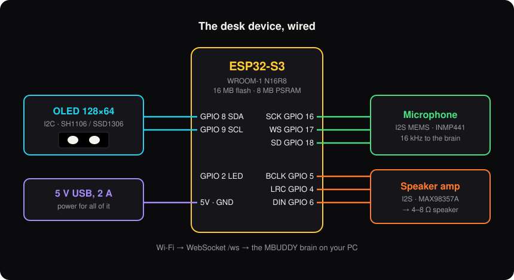
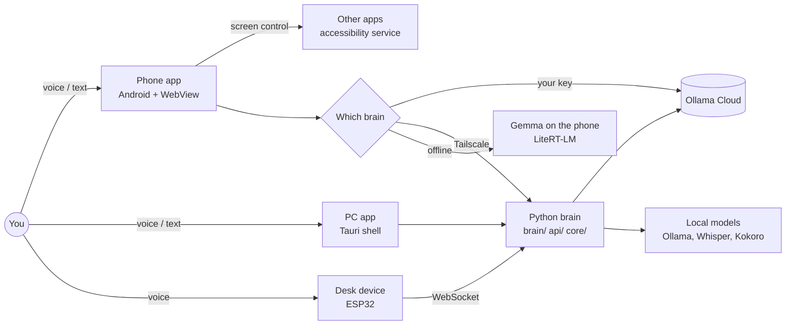

<div align="center">

# MBUDDY

**An open-source AI companion that lives on your PC, your phone and a little device on your desk.**
It listens and talks back, remembers what matters to you, plans your day, looks things up, and does real work inside your
apps: Blender, Word, Excel, your music. It runs on your own hardware with a local model, or on a cloud brain you choose,
and it always asks before it sends, pays, deletes, posts or calls.

**New here?** One command sets up the PC part (`setup.bat`), and [CONTRIBUTING.md](CONTRIBUTING.md) walks you through a
first pull request. Small starter tasks are in [good first issues](docs/GOOD_FIRST_ISSUES.md).

[](https://github.com/bitalchemistio-004/MYBUDDY-V1/actions/workflows/ci.yml)
[](LICENSE)


[](CONTRIBUTING.md)

`Python` · `Tauri` · `Kotlin / Android` · `ESP32` · `local + cloud AI`


<br><sub>The phone app: Today, Do, Notes and Play (the Buddy conversation and Settings are the other two places).</sub>

[**Download**](#download) · [**Quick start**](#quick-start) · [**Using it**](docs/USER_GUIDE.md) · [**Contribute**](#contribute) · [**Docs**](docs/README.md)

</div>

---

## What it is

MBUDDY is one assistant with three bodies:

| | What it is | Where it lives |
|---|---|---|
| **The PC app** | Six spaces (Now, Plan, Studio, Brain, Away, Settings), voice with a wake word, a brain that can see your screen, run apps and learn | [`shell/`](shell) (Tauri) + the Python brain ([`brain/`](brain), [`api/`](api), [`core/`](core)) |
| **The phone app** | A standalone Android app with its own data and brain. It works without the PC, and pairs with it when you want | [`android/`](android) + its screens in [`shell/ui/phoneapp.html`](shell/ui/phoneapp.html) |
| **The desk device** | An ESP32 with a small screen, a microphone and a speaker: the buddy's face on your desk | [`firmware/`](firmware), [`hardware/`](hardware) |

<div align="center">
<br>
<sub>On the PC: the floating buddy at the top of your screen, and the app window. Its quick panel and every space are in <a href="docs/PC_APP.md">docs/PC_APP.md</a>.</sub>
</div>


The buddy is a character you pick (Blink, Void, Glitch, Cinder or Oracle), drawn frame by frame, and it reacts to what is happening.

## What it can do

**Talk and listen**
- "Hey buddy" with a strict offline wake word, or hold the phone's power button (MBUDDY can be your digital assistant).
- Speech is understood on the device (Whisper on the PC, Gemma on the phone) and answered out loud.

**Answer from the web, not from memory**
- A question about the world (facts, news, people, prices, sport) is looked up and answered in a sentence or two, read aloud, with its source.

**Plan your day**
- Tasks, reminders, events and notes by voice or by hand ("remind me to call Baba at 6pm").
- Events go into the phone's own calendar.
- Tapping a task, event or note opens its details, editable.

**Keep your life in one place**
- Five places, and each thing has exactly one home: **Today** (events and tasks with a time), **Do** (tasks without a time), **Notes** (pinned to a day).
- Swipe a row right to finish it, left to push it back an hour or remove it, or press and hold for more. Removing can be undone.
- Export everything to a file and restore it on another phone; a backup copy is made before older data is converted.

**Play with your buddy**
- Eleven games that get harder as you win: Buddy Quest (a dungeon adventure with perks and floors), Snake, Breakout, Catch the stars,
  Tap fast, Buddy says, Mind reader, Word shuffle, Hot and cold, Lights out and Tic-tac-toe.
- The buddy coaches while you play, in its own voice. There is a daily game, a streak with freezes, badges and a weekly recap.

**Stay private**
- **Privacy mode** is one switch (in Settings, the quick-settings tile, or by saying "privacy mode on"). While it is on, MBUDDY does
  not read the screen or other apps' notifications, does not draw over apps, does not listen and does not open other apps.
  It sits beside Android's own privacy switches and says plainly what each one does.

**Work inside other apps**
- On the phone, MBUDDY opens apps, types and taps for you, one step at a time ("open YouTube and play lofi beats").
- Messages go to the app you name (WhatsApp or SMS) with exactly the words you said.
- The buddy reads the message back and waits for your **yes** before anything is sent. It never touches banking, payment, password or security apps.

**Show itself while it works**
- A light around the screen edge and a card in your buddy's colours, in one of two styles:
  - **Bar:** a black bar at the bottom.
  - **Island:** grows out of the phone's real camera cutout, whatever its shape.


**Be on your home screen**
- Widgets for tasks you can tick, ask, play and streak, today, a focus timer, and what is next; launcher shortcuts; and
  quick-settings tiles for Ask MBUDDY and Privacy mode.

**Choose its brain**
- **Cloud:** your Ollama Cloud key, the fastest and smartest.
- **Your PC:** the PC app's brain, over a private Tailscale link.
- **This phone:** Gemma 4 E2B or E4B running offline with LiteRT-LM.

**Auto** tries them in that order, and a brain that just failed is skipped instead of being waited on. Settings → Brain shows each one's live status, with a test button.


<div align="center">
<br>
<sub>The desk device: an ESP32-S3 with a screen for eyes, a microphone and a speaker. Details in <a href="docs/HARDWARE.md">docs/HARDWARE.md</a>.</sub>
</div>

## How it is built



The phone's brain decides in one place ([`Brains.kt`](android/app/src/main/kotlin/app/mbuddy/mobile/Brains.kt)) for a spoken request, the app's ask bar and every step of screen control. The safety rules are in code, not in a prompt:
- Confirmations before sending, paying, deleting, posting or calling: [`Agent.kt`](android/app/src/main/kotlin/app/mbuddy/mobile/Agent.kt).
- Apps that are never operated: [`Screen.kt`](android/app/src/main/kotlin/app/mbuddy/mobile/Screen.kt).

## Repository map

| Folder | What is in it |
|---|---|
| [`android/`](android) | The phone app: brain, screen control, wake word, on-device model, overlay ([`android/README.md`](android/README.md)) |
| [`shell/`](shell) | The PC app (Tauri) and every screen, including the phone app's (`shell/ui/`) |
| [`brain/`](brain) | The PC brain: agent, tools, learning, memory context, connectors to apps |
| [`api/`](api) | The PC's HTTP and WebSocket server, phone gateway, device protocol |
| [`core/`](core) | Settings, voice pipeline, system awareness |
| [`stt/`](stt), [`tts/`](tts), [`audio/`](audio) | Speech in (Whisper) and out (Kokoro), sound effects |
| [`memory/`](memory) | Long-term memory, facts, timeline, vector store |
| [`firmware/`](firmware), [`hardware/`](hardware) | The ESP32 desk device |
| [`tests/`](tests), [`tools/`](tools), [`test_lab/`](test_lab) | Over a thousand tests, benchmarks and checking tools |
| [`docs/`](docs) | Setup guides, architecture, design, the requests ledger and the work journal |

## Download

| You want | Get it |
|---|---|
| **The phone app** | Build it with one command (below), or take the debug APK that every green [CI run](https://github.com/bitalchemistio-004/MYBUDDY-V1/actions/workflows/ci.yml) attaches as `mbuddy-debug-apk`. Copy it to the phone, open it, and allow installs from that source when Android asks. |
| **The PC app and brain** | Clone this repository and run it from source (below). |
| **The desk device** | Wire the parts and flash the firmware: [docs/HARDWARE.md](docs/HARDWARE.md). |

There are no signed store releases yet. A signed, versioned release is on the [maintainer checklist](docs/MAINTAINERS.md); until then
every build comes from source or from CI. Needs: Android 8 or newer (arm64) for the phone app, Windows and Python 3.10 for the PC
brain.

## Quick start

**PC, one command:** `git clone https://github.com/bitalchemistio-004/MYBUDDY-V1.git`, then `cd MYBUDDY-V1` and `setup.bat`.
Download sizes, disk space and every step, part by part: [docs/GETTING_STARTED.md](docs/GETTING_STARTED.md).

**The phone app** (JDK 17 and the Android SDK; the Gradle wrapper is included):
```bash
git clone https://github.com/bitalchemistio-004/MYBUDDY-V1.git
cd MYBUDDY-V1/android
./gradlew :app:assembleDebug
adb install -r app/build/outputs/apk/debug/app-debug.apk
```
Then, on the phone:
1. Open it, say your name and pick your buddy.
2. **Settings → Brain:** paste your Ollama Cloud key, or download an offline model, or pair your PC. Press **Test my brains**.
3. **Settings → Work in other apps:** turn on screen control so it can open and use apps for you.
4. **Settings → Calling me:** make MBUDDY your assistant (hold the power button) and, if you want, turn on "hey buddy".
5. Try: *"how tall is Mount Everest"*, *"remind me to call Baba at 6pm"*, *"open YouTube and play lofi beats"*.

**The PC brain** (Windows, Python 3.10):
```bash
python -m venv .venv
.venv\Scripts\activate
pip install -r requirements.txt
copy .env.example .env      # then add your keys in .env
python main.py
```

**The PC app** (Node and Rust for Tauri):
```bash
cd shell
npm install
npm run dev
```

**The desk device:** wire an ESP32-S3, a 128×64 OLED, an I2S microphone and an I2S speaker amplifier, then flash
[`firmware/mbuddy`](firmware/mbuddy) with PlatformIO (`pio run -t upload`). Parts, wiring and steps are in
[`docs/HARDWARE.md`](docs/HARDWARE.md).

## Using it

| Part | What to read |
|---|---|
| The phone app, every screen and what to say | [docs/USER_GUIDE.md](docs/USER_GUIDE.md) |
| The phone app, install and first run | [docs/setup/PHONE_APP.md](docs/setup/PHONE_APP.md) |
| The PC app, its six spaces and the floating buddy | [docs/PC_APP.md](docs/PC_APP.md) |
| The desk device | [docs/HARDWARE.md](docs/HARDWARE.md) |
| Cloud brain and pairing the phone with the PC | [docs/setup/CLOUD_BRAIN_AND_PHONE.md](docs/setup/CLOUD_BRAIN_AND_PHONE.md) |
| Building, signing and versions | [docs/BUILD.md](docs/BUILD.md) |
| How it fits together | [docs/ARCHITECTURE.md](docs/ARCHITECTURE.md) |

## Tests

```bash
python -m pytest -q                              # the PC brain and server
node --test shell/ui/tests/*.test.mjs            # the phone app's page: data, games, restore, parsing
cd android && ./gradlew :app:testDebugUnitTest   # the phone app's safety rules
```
What each test set covers is in [`tests/README.md`](tests/README.md).
The phone app is also checked on a real phone before every install, by a regression suite that runs real requests in test mode (every confirmation is answered "no", so nothing is ever sent or called).

## Principles

- **Real or nothing.** Every feature is wired to real state. A tool returns real data or says it failed; nothing is faked.
- **Your yes is required** for anything that sends, pays, deletes, posts or calls. Silence is a no.
- **Your choice.** Which brain, which app handles what, which buddy, which style.
- **Private by default.** Data stays on your devices. Keys are encrypted on the phone and never shown to a page.
- **Measured, not guessed.** Changes are checked on the real device, with numbers, before they are merged.

## Contribute

MBUDDY is open source and wants people to build it with. You do not need to know the whole project: pick a part.

| If you like | Work on | Start here |
|---|---|---|
| Kotlin and Android | The phone app: screen control, wake word, overlay, widgets | [`android/`](android), [docs/BUILD.md](docs/BUILD.md) |
| JavaScript and design | The phone and PC screens, games, animations | [`shell/ui/`](shell/ui) |
| Python and AI | The PC brain, tools, memory, speech | [`brain/`](brain), [`api/`](api), [`core/`](core) |
| Electronics and C++ | The ESP32 desk device | [`firmware/`](firmware), [`hardware/`](hardware) |
| Writing and testing | Guides, translations, bug reports, real-phone checks | [`docs/`](docs), [`tests/`](tests) |

**The way in**
1. Pick a task: issues labelled `good first issue`, or the ranked list in [docs/GOOD_FIRST_ISSUES.md](docs/GOOD_FIRST_ISSUES.md).
2. For anything big, open an issue first so the work is not wasted.
3. Fork, branch, change, and run the tests (see [Tests](#tests)). The page tests and the Android unit tests run on every pull request.
4. Open a pull request using the template. Explain what changed and how you checked it.

**Ground rules** (the short version of [`CONTRIBUTING.md`](CONTRIBUTING.md))
- Real or nothing: a feature is wired to real state, or it is not shown.
- Anything that sends, pays, deletes, posts or calls waits for the user's yes, and that rule lives in code, not in a prompt.
- Check changes on the real device where you can, and say what you did and did not check.

Be kind: see the [Code of Conduct](CODE_OF_CONDUCT.md). How decisions are made is in [`GOVERNANCE.md`](GOVERNANCE.md).
Found a security problem? Report it privately: [`SECURITY.md`](SECURITY.md). Need help? [`SUPPORT.md`](SUPPORT.md).

## Licence

MBUDDY is free software under the [GNU General Public License v3.0](LICENSE). Third-party components and their licences are listed in
[`THIRD_PARTY_NOTICES.md`](THIRD_PARTY_NOTICES.md). Changes are recorded in [`CHANGELOG.md`](CHANGELOG.md).

## Documentation

Start at [`docs/README.md`](docs/README.md):
- Setup: [cloud brain and phone](docs/setup/CLOUD_BRAIN_AND_PHONE.md), [phone app](docs/setup/PHONE_APP.md).
- Architecture: [system overview](docs/architecture/SYSTEM_OVERVIEW.md).
- History: what changed in each version, in the [changelog](CHANGELOG.md).
