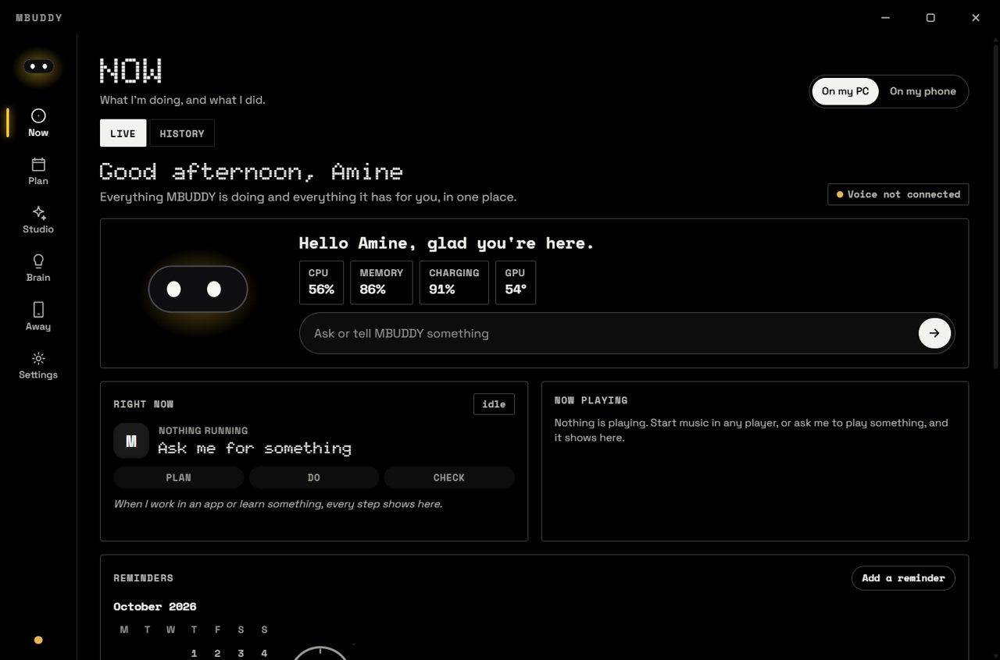

# MBUDDY on the PC

The PC app is the buddy's home base. It is a desktop app (Tauri, in [`shell/`](../shell)) with the brain running beside it in Python
([`brain/`](../brain), [`api/`](../api), [`core/`](../core)). It listens and talks, sees what is on your screen when you allow it, plans
your day, runs apps for you, learns from what works, and is the brain the phone and the desk device can borrow.



## How it looks

Three things on your desktop:

**1. The floating buddy.** A small black pill that sits at the top of your screen, over every app, always on top. It shows the
buddy's face, whether it is listening, and the time, and it glows in your buddy's colour. It never takes a click it does not need:
the rest of its window lets clicks through to the app underneath.


**2. The quick panel.** Click the buddy and it opens in place: an ask bar, and one-tap actions for the microphone, your phone, a
timer, a reminder, tasks, the calendar, ideas, a focus sprint, music, sleep and the main window.


**3. The app window.** A black window with one glowing colour (your buddy's), dotted type for titles, and a rail of six spaces on
the left. An ask bar sits at the bottom of every space.

| | |
|---|---|

## The buddy at work

The floating buddy changes with what is going on. It widens to show what it is saying, asking or doing, and its glow changes
colour: violet while it thinks, red for a timer, gold for a job or a question, pink for music.

**Talking with you**

| | |
|---|---|

**Timers and reminders**

| | |
|---|---|

**Working in your apps.** When it does a job in an app, the pill shows the app, the task and how far along it is. It checks that the
work really happened before it calls it done. When it is learning a new app it shows which try it is on.

| | |
|---|---|

**Playing music.** The glow turns pink and the pill shows the track. Click it for the player: the record turning, the time, the
controls, and the volume of the app that is playing.


## The six spaces

The app is in the Nocturne look (true black, one glowing colour, dotted type). An ask bar sits at the bottom of every space: type or talk.

| Space | What it holds |
|---|---|
| **Now** | The buddy and its state, the computer's state (CPU, memory, charging, GPU), what is running, what is playing, the conversation, approvals waiting for you, and the history of what was done |
| **Plan** | Calendar, tasks and reminders, focus sprints, routines, and your day at a glance |
| **Studio** | Create (writing, and work inside an app), Music (with your choice of player, and what you like), Library |
| **Brain** | What it has learned, recipes, the apps it can use, and its notes and memory |
| **Away** | Pairing with your phone, the private network, approvals from the phone, a kill switch, and a log of what was done remotely |
| **Settings** | Models (local and cloud, with a spend meter and "ask before sending to the cloud"), Buddy, Voice, Apps, Privacy, System |

The **floating buddy** and its **quick panel** sit over your other apps (see above).

## What it can do

- **Talk**: a "Hey buddy" wake word (openWakeWord), speech understood on your GPU (faster-whisper) and spoken back in a natural voice
  (Kokoro), with a voice colour for each feeling.
- **Think with the brain you choose**: a local model through Ollama (a 4B model fits a 6 GB GPU), Ollama Cloud with your key, or Groq.
  A router picks the cheapest model that can do the job and asks before anything goes to the cloud.
- **Use your PC**: open and switch apps, write in Word, work through an app's own screens (`brain/connectors/app_driver.py`), control
  music, read the clipboard, and check that what it did really happened (`brain/verification.py`).
- **Know what you are doing** (optional): screen awareness, so it can help with what is in front of you.
- **Remember**: facts about you, a timeline, a vector store for meaning, and an Obsidian vault it can read and write.
- **Learn**: lessons from tasks that worked, tried as a guess first and kept once proved; recipes it can replay.
- **Plan**: reminders that ring, calendar files, routines, focus sprints.
- **Serve the phone and the desk device**: a WebSocket for the ESP32, and a phone gateway reached over Tailscale.

## Install

You need Windows 10 or 11, Python 3.10, and for the app window Node.js and Rust (Tauri's prerequisites). An NVIDIA GPU is used for
speech when present.

```bash
git clone https://github.com/bitalchemistio-004/MYBUDDY-V1.git
cd MYBUDDY-V1
python -m venv .venv
.venv\Scripts\activate
pip install -r requirements.txt
copy .env.example .env
```

Open `.env` and set at least one brain:

- **Local** (the default): install [Ollama](https://ollama.com) and run `ollama pull qwen3:4b-instruct`. `BRAIN_PROVIDER=ollama` is already set.
- **Cloud**: set `OLLAMA_API_KEY` (Ollama Cloud) or `GROQ_API_KEY`.

Then start the brain, and the app beside it:

```bash
python main.py              # the brain and server (WebSocket on port 5000, the app's API)
cd shell
npm install
npm run dev                 # the app window (npm run build makes an installer)
```

`python check_system.py` checks your setup and reports what is missing, without changing anything.

## Reach it from your phone

1. Install [Tailscale](https://tailscale.com) on the PC and the phone, same account.
2. On the PC, once: `tailscale serve --bg 5051`.
3. In the app: Away, New pairing code. On the phone: Settings, Your PC, the address and the six digits.

More in [setup/CLOUD_BRAIN_AND_PHONE.md](setup/CLOUD_BRAIN_AND_PHONE.md).

## Good to know

- The server's `/control/*` routes trust the local machine, so do not expose port 5000 to the internet. Use Tailscale for remote use.
- Your keys live in `.env`, which git ignores.
