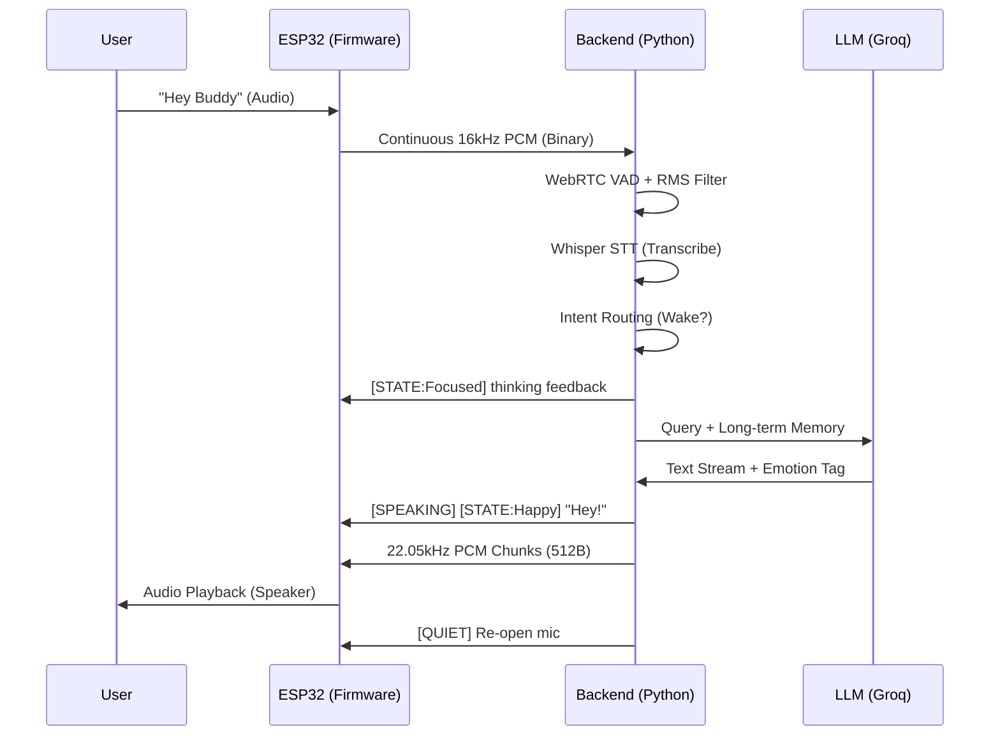

# MBUDDY System Architecture

MBUDDY is a high-fidelity AI companion designed for low-latency voice interaction and emotional expression. It uses a hybrid architecture: real-time DSP and animation on the **ESP32** (Firmware), and heavy-lifting AI/VAD/TTS on the **Python Backend**.

## 1. High-Level Logic Flow

## 2. Component Breakdown

### A. ESP32 Firmware (MBUDDY.ino)
*   **Dual-Core Multi-tasking:**
    *   **Core 0 (Animation & Playback):** Runs the `Face` engine (OLED rendering) and the `audioTask` (pull pulls from a ~80-112KB RingBuffer to stream to the MAX98357A I2S DAC).
    *   **Core 1 (Sensing & Communication):** Runs the `micTask` (captures 16kHz audio from INMP441, applies DC blocking and digital gain) and manages the WebSocket client.
*   **Barge-in Logic:** Adaptive RMS tracking. If user voice energy exceeds `3.2x` ambient floor (amplified by `6.5x` during system speech), it sends `[BARGE]` and kills local audio playback instantly.
*   **Buffer Management:** Uses a large `FreeRTOS RingBuffer` to bridge network jitter during TTS playback.

### B. Backend API (websocket_server.py)
*   **VAD Pipeline:** Uses `webrtcvad` for speech detection, then passes confirmed speech through a hallucination guard that filters out Whisper "ghost" transcripts (e.g., "Thank you for watching").
*   **Protocol:**
    *   **Incoming:** Binary (PCM chunks), Text (`[BARGE]`, `keep-alive`).
    *   **Outgoing:** Text tags (`[SPEAKING]`, `[QUIET]`, `[THINKING]`, `[STATE:...]`) and Binary PCM (22.05kHz mono).
*   **Deduplication:** MD5 fingerprints of transcripts prevent rapid echo/hallucination loops.

### C. The Brain (brain/ & memory/)
*   **LLM Routing:** Streams from Groq (Llama 3/3.3). Extracts emotional intent (e.g., `[HAPPY]`) mid-stream to update eyes before speech starts.
*   **Tiered Memory:**
    *   **Short-term:** Recent conversation history.
    *   **Long-term (JSON):** "Core Facts" about the user.
    *   **Vector Store:** Semantic search for relevant past context.
*   **Personality:** Managed via `brain/personality.py`. Influences TTS prosody (pitch/rate) and eye animations.

### D. Audio Pipeline (stt/ & tts/)
*   **STT:** Groq Whisper (Remote) or Local Whisper. Uses specialized prompts for Lebanese Arabic/English mixing.
*   **TTS:** `edge-tts` (Neural). Audio is synthesized in the cloud, decoded to raw PCM on the server, and streamed to the ESP32 in small, heap-friendly 512B frames.

## 3. Hardware Interconnects

| Component | Protocol | Pins (ESP32) |
|-----------|----------|--------------|
| **INMP441 (Mic)** | I2S | SCK:16, WS:17, SD:18 |
| **MAX98357A (Amp)** | I2S | BCLK:26, LRC:25, DIN:27 |
| **SSD1306 (OLED)** | I2C | SDA:21, SCL:22 |
| **Status LED** | GPIO | 2 |

## 4. Key Sequences

### The Wake Sequence
1. ESP32 detects voice energy but stays in `State::Sleepy`.
2. Audio streamed to Backend.
3. Backend detects "Hey Buddy".
4. Backend sends `[STATE:Focused]` + Wake Greeting.
5. ESP32 transitions to `Normal` rhythm.

### The Barge-In Sequence
1. Backend is streaming TTS PCM. ESP32 is playing.
2. User interrupts loudly.
3. ESP32 `micTask` detects high energy vs `ambientNoiseFloor * multiplier`.
4. ESP32 `micTask` calls `flushAudioBuffer()` (silence) and sends `[BARGE]`.
5. Backend receives `[BARGE]`, cancels its own response task, and stops streaming.
6. System resets to listening state.

---
*Documentation generated for the user's MBUDDY Project.*
