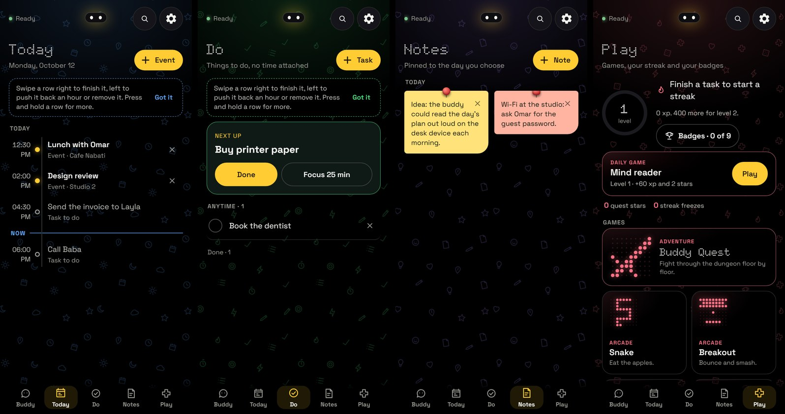

# MBUDDY on the phone

The Android app ([`android/`](../../android)) is MBUDDY as an app of its own. It keeps its own data on the phone and has its own brain,
so it works without the PC; pairing with the PC is optional.



The app has five places and one way to ask. A full tour and what to say is in [../USER_GUIDE.md](../USER_GUIDE.md).

- **Buddy**: the conversation and the ask bar (type or tap the microphone).
- **Today**: events and tasks that have a time. **Do**: tasks without a time. **Notes**: notes pinned to a day.
- **Play**: eleven games, a daily game, your streak and badges.
- **Settings** (the gear): your buddy, Brain, Calling me, Work in other apps, While I work, Your PC, Your data, Smart behaviours,
  Permissions.

## What it can do

- **Answer from the web**: a question about the world is looked up and answered aloud in a sentence or two.
- **Plan**: tasks, reminders, events (written into the phone's calendar), notes, timers, alarms, focus sprints, by voice or by hand.
- **Message and call**: "send hi to Baba on WhatsApp" opens that chat with exactly the words you said. The buddy reads the message
  back and waits for your yes. "Call Baba" asks "Call Baba now?" first.
- **Work inside other apps** (screen control): it opens apps, types and taps, one step at a time.
  - It waits for each screen to finish loading before acting.
  - It asks before it sends, pays, deletes, posts or calls.
  - It never operates banking, payment, password or security apps.
- **Show itself while it works**: a light around the screen edge and a card, in one of two styles:
  - **Bar:** a black bar at the bottom.
  - **Island:** grows out of the camera cutout on any phone, or the top centre when there is none.
  - Options: colourful light, and showing each step.
- **Be called like an assistant**:
  - Hold the power button with MBUDDY set as the phone's digital assistant; no microphone stays on.
  - Or say "hey buddy". This keeps the microphone on, because only Google's assistant gets the phone's low-power listening chip.
- **Stay private**: Privacy mode (Settings, the quick tile, or "privacy mode on") stops screen reading, other apps'
  notifications, the overlay, listening and opening apps.
- **Play and keep your streak**: games the buddy coaches, a daily game, streak freezes, widgets and quick tiles.
- **Choose its brain**:
  - **Cloud:** your Ollama Cloud key, the quickest and smartest.
  - **Your PC:** over Tailscale.
  - **This phone:** Gemma 4 E2B or E4B, offline.
  - **Auto** tries them in that order and skips one that just failed. Settings → Brain shows each one's status, with "Test my brains".

## Install

**From a built file**: copy `app-debug.apk` to the phone and open it (allow installing from this source when Android asks).

**Build it yourself** (no Android Studio needed): JDK 17 and the Android SDK; the Gradle wrapper is included. The details are in
[`../BUILD.md`](../BUILD.md) and [`android/README.md`](../../android/README.md).

```bash
cd android
./gradlew :app:assembleDebug
adb install -r app/build/outputs/apk/debug/app-debug.apk
```

## First run

1. Open the app, say your name, pick your buddy.
2. **Settings → Brain**: paste your cloud key and Save. Or, under Model on this phone, download Gemma 4 E2B (2.6 GB, use Wi-Fi).
   Press **Test my brains**: each brain shows green when it answers.
3. **Settings → Work in other apps**: turn on screen control (Android opens its own switch).
4. **Settings → Calling me**: make MBUDDY your assistant, and turn on "hey buddy" if you want it.
5. **Settings → While I work**: pick Bar or Island and press Preview.
6. Try: "how tall is Mount Everest", "remind me to call Baba at 6pm", "open YouTube and play lofi beats".

## Good to know

- Some phones (Xiaomi among them) switch screen control off when the app is reinstalled. The buddy tells you so, with one tap to turn
  it back on.
- The model on the phone is slow (5 to 12 s an answer) and the screens stutter while it thinks; the cloud brain has neither problem.
- Your cloud key is encrypted with the phone's secure hardware and never given to the app's screens.
